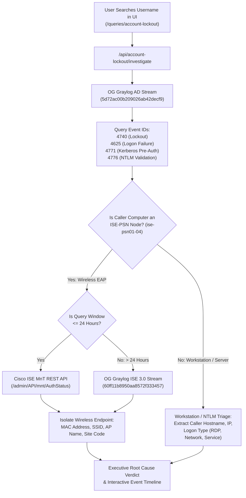

# Account Lockout & Auth Failure Investigator

## 1. Overview & Architecture

The **Account Lockout & Auth Failure Investigator** (`/queries/account-lockout`) is an enterprise forensic utility designed to rapidly isolate the root cause and physical or network source of Active Directory user account lockouts.

It solves a common enterprise challenge: Active Directory security event 4740 records a lockout event, but when the caller device is a Cisco ISE Policy Service Node (`ise-psn01` through `ise-psn04`), the lockout is driven by wireless 802.1X EAP authentications (such as mobile devices, laptops, or tablets repeatedly authenticating with cached or expired credentials).

---

## 2. Telemetry Sources & Stream IDs

### 1. Active Directory Domain Controller Security Logs
- **Source:** OG Graylog (`https://graylog.cooperhealth.edu:9000`)
- **Stream ID:** `5d72ac00b209026ab42decf9`
- **Monitored Event IDs:**
  - **`4740`**: A user account was locked out. Authoritative event that records the exact timestamp, Domain Controller, and `CallerComputerName`.
  - **`4625`**: An account failed to log on. Contains logon type (e.g. Type 10 for RDP, Type 3 for network share), failure status, and sub-status codes.
  - **`4771`**: Kerberos pre-authentication failed. Usually indicates bad password (`0x18`) or expired password (`0x17`).
  - **`4776`**: Domain Controller attempted to validate credentials for an account (NTLM authentication package).

### 2. Cisco ISE Policy Service Nodes (Wireless 802.1X EAP)
- **Hostnames:** `ise-psn01`, `ise-psn02`, `ise-psn03`, `ise-psn04`
- **Wireless Correlation Engine:**
  - When the caller device in event 4740 or failure events matches `/ise-psn0[1-4]/i`, the tool pivots to Cisco ISE telemetry.
  - **Lookback $\le$ 24 Hours:** Queries Cisco ISE MnT REST API (`/admin/API/mnt/AuthStatus/userName/...`) for real-time authentication records, extracting the endpoint MAC address, SSID (e.g., `Cooper-Secure`), Calling Station ID, AP location, and NAS IP.
  - **Lookback > 24 Hours:** Since ISE MnT database purges transient authentications after 24 hours, queries older than 24h automatically fall back to OG Graylog Stream `60ff11b8950aa8572f333457` (`ISE 3.0 Syslog Archive`) to ensure historical correlation up to 7 days.

---

## 3. Workstation & Host Logon Type Classification

When the calling device is not an ISE-PSN node, the tool parses the Windows Logon Type to classify the exact access mechanism:

| Logon Type | Meaning | Common Culprit |
| :--- | :--- | :--- |
| **Type 10** | RemoteInteractive (RDP) | Stale remote desktop session, disconnected terminal session running a background process, or saved RDP credentials. |
| **Type 3** | Network (SMB / RPC) | Mapped network drive (`Z:\`), persistent DFS share, printer connection, or credential manager cached password. |
| **Type 4 / 5** | Batch / Service | Windows Service or Scheduled Task running under the user's service account with an expired password. |
| **Type 2** | Interactive (Console) | Physical workstation console or laptop where the user forgot to log off. |
| **Type 7** | Unlock Workstation | Workstation lock screen with a cached or mistyped password. |
| **Type 8** | NetworkCleartext | Web application or legacy IIS service passing basic authentication. |

---

## 4. Dashboard Features & Layout

### 1. Pinned Search Toolbar
- **Standard `SmartSearchBar`:** Unified search bar with auto-trimming, keyboard navigation (`Enter` to submit, `Esc` to clear), and live account type detection (`UPN / Email` vs `AD Account`).
- **Time Window Selection:** Quick lookback filters: `1h`, `4h`, `12h`, `24h`, and `7d`.
- **Query Indicators:** Displays connected stream IDs (`5d72ac00b209026ab42decf9`) and PSN detection range (`ise-psn01`–`04`).

### 2. Executive Root Cause Verdict & Metrics Ribbon
- **Metrics Ribbon:** Summarizes Lockout State (Event 4740 count and latest timestamp), Primary Culprit (Host vs ISE Wireless EAP), Total Failures (4625/4771/4776), and Queried User.
- **Verdict Banner:** Highlights the high-confidence root cause category (`WIRELESS_EAP_STALE_CREDS`, `WORKSTATION_RDP_SESSION`, `NETWORK_SMB_SHARE`, `SCHEDULED_TASK_OR_SERVICE`, `BAD_PASSWORD_SPAM`) with step-by-step remediation advice for analysts.
- **Deep-Dive Triage Cards:**
  - **Wireless Triage Card:** Displays Endpoint MAC, SSID, AP Name, Site Code, and failure reason when caused by ISE-PSN.
  - **Workstation Triage Card:** Displays Caller Hostname, IP, Logon Type, and likely cause.

### 3. Failure Frequency Timeline
- Interactive Recharts area chart plotting failure volume and lockout events over time to identify whether failures are sudden bursts (single bad login) or persistent cyclical spam (mobile device background polling).

### 4. Interactive Event Stream Table
- **Standard `PaginationControls`:** Top and bottom pagination with selectable limits (`10`, `25`, `50`, `100` rows per page).
- **Column Filtering:**
  - Filter tabs for Event IDs: `All`, `4740 (Lockout)`, `4625 (Fail)`, `4771 (Kerb)`, `4776 (NTLM)`.
  - Dropdowns for **Caller Machine**, **Domain Controller**, and **Logon Type**.
  - Client-side search bar for instant keyword filtering.
  - Reset filters button to return to default view with 1 click.
- **Sortable Columns:** Clickable headers for Time, Event ID, Caller, Source IP, Domain Controller, and Logon Type with visual sort direction indicators.
- **Inline Expandable Rows:** Clicking any row or its chevron button (`^` / `v`) expands the full forensic payload and formatted triage breakdown directly in place with a 1-click **Copy Raw Log** button.

---

## 5. Security & RBAC Permissions

Access to `/queries/account-lockout` is governed by the Pane-o-Glass dynamic permission matrix:
- **Default Permissions:** Registered across all 6 roles (`ADMIN`, `ANALYST`, `NETWORK`, `DESKTOP`, `SYSTEMS`, `USER`), but enabled **only for `ADMIN` by default**.
- **Admin Configuration:** Administrators can enable access for other roles (e.g. `ANALYST` or `DESKTOP`) via `/users/permissions`.
- **Defense-in-Depth:**
  - Sidebar link is hidden unless the user has the `account-lockout` entitlement.
  - Page route displays a server-side `Access Denied` screen if unauthorized.
  - API endpoint (`/api/account-lockout/investigate`) enforces 403 Forbidden checks.
  - All investigation queries log an audit event (`ACCOUNT_LOCKOUT_INVESTIGATE`) to the database.
